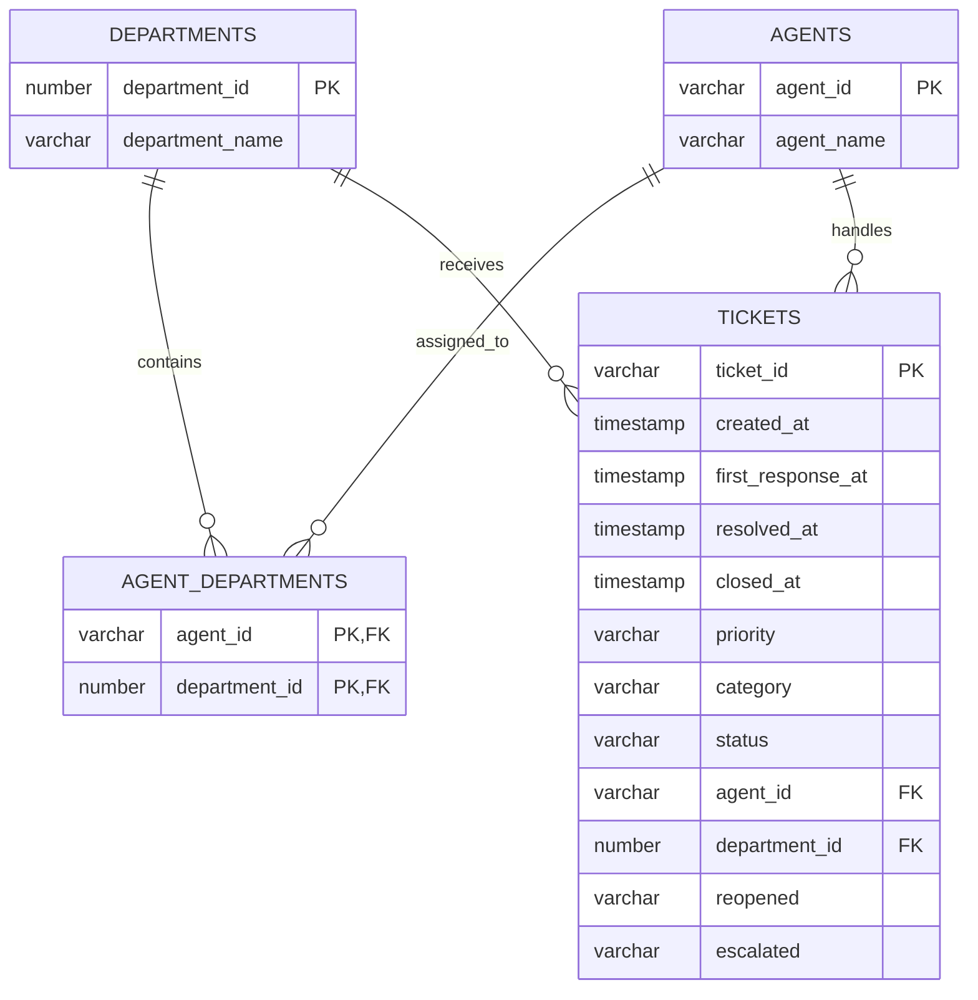

# ITSM Analytics – ER Diagram and Star Schema

## 1. Project Database Overview

The ITSM Analytics system uses a relational database to manage IT help-desk tickets, departments, agents, and agent-department assignments.

The database consists of four primary tables:

1. DEPARTMENTS
2. AGENTS
3. AGENT_DEPARTMENTS
4. TICKETS

## 2. Entity Relationships

- One department can be associated with multiple agents.
- One agent can work across multiple departments.
- AGENT_DEPARTMENTS manages the many-to-many relationship between agents and departments.
- Each ticket is associated with an assigned agent and department.
- Each ticket has a unique ticket ID.

## 3. ER Diagram

## 4. Star Schema Design

For analytical reporting, the ticket records can be represented through a star schema.

### Fact Table

FACT_TICKETS

Contains measurable ticket-related information:

- Ticket count
- Resolution time
- First response time
- SLA target hours
- SLA breach indicator
- Reopened indicator
- Escalation indicator

### Dimension Tables

- DIM_DATE: Date-related analysis.
- DIM_AGENT: Agent performance analysis.
- DIM_DEPARTMENT: Department performance analysis.
- DIM_PRIORITY: Priority-wise analysis.
- DIM_CATEGORY: Category-wise analysis.

## 5. Analytical Benefits

The proposed star schema supports:

- SLA performance reporting.
- Agent performance comparison.
- Department-level analysis.
- Priority-wise ticket monitoring.
- Category-wise ticket analysis.
- Ticket aging and backlog monitoring.
- Reopened and escalated ticket analysis.

## 6. Implementation Note

The normalized Oracle database is implemented using the four relational tables described above. The star schema is a proposed analytical reporting model and is not claimed to be a separately implemented physical database.